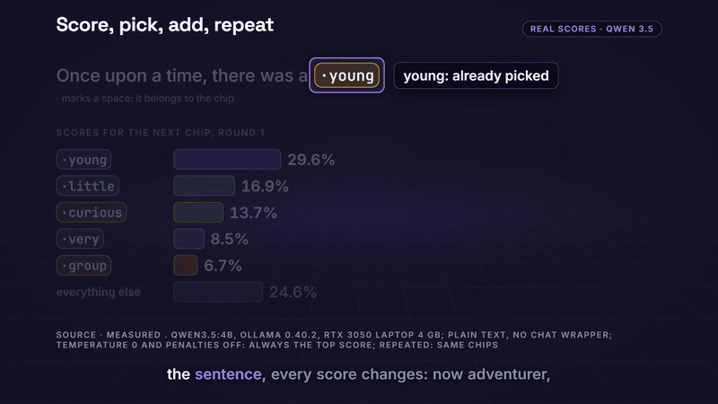

# Runs Locally Studio

**Narrated, word-synced explainer videos from a JSON script — made entirely on your own machine.**

You write the narration and the scenes as data. A local voice ([Kokoro](https://huggingface.co/hexgrad/Kokoro-82M)) reads it,
[whisper.cpp](https://github.com/ggml-org/whisper.cpp) measures when every word is spoken, and [Remotion](https://www.remotion.dev)
renders 1080p animation that moves at the moment the voice names something. No API keys, no cloud services, no editing app.

This is the engine behind the [Runs Locally](https://www.youtube.com/@RunsLocally) YouTube channel.

<p align="center">
  
</p>
<p align="center"><sub>Real frames from <a href="https://youtu.be/vSUqRwplAT4"><b>How Does AI Pick the Next Word?</b></a> — every bar is a real score (logprob) from qwen3.5:4b on a 4 GB laptop, and each pick lands as the voice says it. <a href="https://youtu.be/vSUqRwplAT4">Watch it with sound</a>. Its script, raw data and harness are in <a href="content/how-ai-picks-the-next-word"><code>content/how-ai-picks-the-next-word</code></a>.</sub></p>

## What you get

- **Cues tied to spoken words.** A scene says `"at": "@adventurer"`, not "at frame 2,140". Change the words, re-voice, and every pointer, highlight and zoom moves with them.
- **Local, no API keys.** Kokoro TTS (runs on the CPU, no GPU needed), whisper.cpp alignment and Remotion rendering all run on your machine. The only network use: the one-time downloads (models, Remotion's headless Chrome) and the Google Fonts that Remotion loads while rendering.
- **Lesson scenes that explain:** tokens as chips, a code editor + terminal that replay a real run, streaming races, trial grids, a context window, memory bars, next-word scores with a pick animation, plus classic title / stat / compare / list / callout / verdict / end cards and real screen captures.
- **Checks before you publish:** whisper listens to the voiced audio and flags missing words; every scene that shows numbers needs a source line; something must move at least every 7 seconds; contact sheets of the rendered file. See [docs/gates.md](docs/gates.md).
- **Everything a video needs:** burned-in captions and an `.srt` file, a thumbnail, vertical Shorts (1080x1920), and measured word timings to compute chapters from (the example's `harness/build-publishing.mjs` does).
- **One command:** `node scripts/make.mjs <slug>` runs the whole pipeline and stops at the first problem.

## Quick start

You need **Node.js 20+**, **Python 3.10–3.12**, **ffmpeg** on your PATH and **espeak-ng** (Kokoro's fallback for words it does not know; on Windows the default install folder is found automatically, macOS `brew install espeak-ng`, Linux `apt install espeak-ng`). Disk: about 1.5 GB in total — `node_modules` ~350 MB, Remotion's headless Chrome ~115 MB, whisper.cpp + the small.en model ~490 MB, the Kokoro model ~315 MB (both models download on first use).

```bash
git clone https://github.com/haider484991/runs-locally-studio
cd runs-locally-studio
npm install
pip install -r requirements.txt        # Windows: py -3 -m pip install -r requirements.txt
```

Preview every video in Remotion Studio (silent, with estimated timing until it is voiced):

```bash
npm run dev
```

Make the hello-world video end to end (voice → align → checks → render → captions → contact sheets):

```bash
node scripts/make.mjs hello-world
```

Output: `out/hello-world.mp4`, `out/hello-world.srt`, `out/hello-world-thumb.jpg` and `out/review-sheets-hello-world/`.
On the test laptop (Ryzen 7 6800HS, Windows 11) the 57-second hello-world took 3.6 minutes, including Remotion's one-time Chrome download (whisper.cpp and the Kokoro model were already downloaded).

### Make your own

```bash
npm run new my-first-video                 # writes content/my-first-video/script.json
# edit the narration and visuals, preview with npm run dev
node scripts/make.mjs my-first-video
```

Then **look at it**: watch the MP4 and open every contact sheet. A pipeline that finishes is not a video that explains.

## How a scene works

A video is a list of beats. Each beat has the words the voice says and a visual. This is the code beat of `content/hello-world` (shortened):

```jsonc
{
  "id": "b02",
  "narration": "Here is a real program, run on this computer. It splits one sentence into words and counts them. Run it, and it prints nine words. The longest one is picture.",
  "visual": {
    "type": "explain", "scene": "code", "badge": "Replay of a real run",
    "source": "Measured . the file and its output from evidence/code-run.json (Node v22.16.0)",
    "data": { "file": "count-words.mjs", "lines": ["…the real file…"], "runs": [{ "cmd": "node count-words.mjs", "out": ["9 words", "longest: picture"] }] },
    "cues": [
      { "at": "@program", "do": "focus", "target": "code", "label": "the file that ran" },
      { "at": "@splits",  "do": "point", "target": "line:2:19-24" },
      { "at": "@run",     "do": "run",   "run": 0 },
      { "at": "@nine",    "do": "focus", "target": "out:0:0", "label": "its real output" }
    ]
  }
}
```

`"@nine"` resolves to the frame where the voice actually says "nine", measured by whisper. The lines and the output are not typed by hand: [`content/hello-world/harness/build.mjs`](content/hello-world/harness/build.mjs) runs the program and writes them into the script, so the video cannot show code that never ran.

Every cue verb, target and scene is documented in [src/explain/README.md](src/explain/README.md).

## The pipeline

```
content/<slug>/script.json
  → scripts/stage.mjs       copy to public/, register the compositions
  → scripts/check.mjs       source gates
  → scripts/tts.py          Kokoro: one WAV per beat, normalised to -16 LUFS, cached by text
  → scripts/align.mjs       whisper.cpp: the start and end of every spoken word → public/<slug>/timings.json
  → scripts/check.mjs       timing gates
  → scripts/asr-check.mjs   whisper listens to the voice: no stretch of 3+ script words may be missing
  → scripts/render.mjs      Remotion: out/<slug>.mp4 + out/<slug>-thumb.jpg
  → scripts/srt.mjs         captions file from the measured timings
  → scripts/sheets.mjs      contact sheets of the rendered file: three frames per beat
```

Other tools: `scripts/frames.mjs <slug> --cues` (a still after every cue, before rendering), `scripts/thumb-shot.mjs concept.html out.jpg` (thumbnails written as HTML, shot with headless Chrome), `scripts/render-short.mjs` and `scripts/short-frames.mjs` (vertical Shorts).
Settings: `KOKORO_VOICE`, `KOKORO_SPEED`, `WHISPER_MODEL` (default `small.en`), `WHISPER_DIR` (reuse an existing whisper.cpp folder), `RENDER_CONCURRENCY`, `REMOTION_GL`, `CHROME_PATH`, `PYTHON`.

## The flagship example: real data, from measurement to video

[`content/how-ai-picks-the-next-word`](content/how-ai-picks-the-next-word) is the complete source of a published video:

- `harness/nextword-runs.py` asks a local model (Ollama, qwen3.5:4b) for the scores of its next-word candidates and for 100 random draws, and saves every run in `evidence/`.
- `harness/build-script.mjs` turns those files into the script: every number in the narration and on screen is read from the evidence and spelled out by code, and the build stops if the data no longer supports a sentence.
- `brief.json` is the editorial brief (strict mode, [docs/gates.md](docs/gates.md)); `evidence/README.md` lists what was and was not tested.

The evidence is included, so `node scripts/make.mjs how-ai-picks-the-next-word` works without Ollama. To measure it yourself: install [Ollama](https://ollama.com), `ollama pull qwen3.5:4b`, then from the `harness` folder run `python nextword-runs.py greedy 10` and `python nextword-runs.py sample 100`, and rebuild the script with `node content/how-ai-picks-the-next-word/harness/build-script.mjs`.
Its Short: after rendering the long video, `node content/how-ai-picks-the-next-word/harness/build-short.mjs --clips` cuts the clips, then `node scripts/make.mjs how-ai-picks-the-next-word-short`.

## Project layout

```
content/<slug>/        script.json (+ brief.json, evidence/, harness/, thumbs/) — the source of a video
public/<slug>/         generated: staged script, voiced audio, timings (git-ignored)
out/                   generated: videos, thumbnails, captions, contact sheets (git-ignored)
src/                   Remotion: Video.tsx, Short.tsx, Thumb.tsx, scenes/, explain/ (lesson scenes), kit/, heroes/ (one-off scenes)
scripts/               the pipeline (see above) and its tests (npm test)
docs/                  gates.md (the checks), design.md (the visual system)
```

## Status

Tested end to end on Windows 11 (Node 22.16, Python 3.11.9, ffmpeg 8.1, PyTorch CPU build). The macOS and Linux code paths (whisper.cpp built from source by `@remotion/install-whisper-cpp`, `python3`, Chrome locations, fonts) are written but **not yet tested** — reports and fixes are welcome. Only English voices have been used.

## License and credits

- This repository: [MIT](LICENSE).
- **Remotion is not MIT.** It is free for individuals, for-profit organizations with up to 3 employees, non-profits, and for evaluation; larger companies need a [Remotion company license](https://www.remotion.dev/license).
- [Kokoro-82M](https://huggingface.co/hexgrad/Kokoro-82M) (voice): Apache-2.0. [whisper.cpp](https://github.com/ggml-org/whisper.cpp): MIT. Fonts load from Google Fonts (SIL Open Font License).
- Built with the help of [Claude Code](https://www.anthropic.com/claude-code).

## Support

- ⭐ **Star the repo** if it is useful: it helps other people find it.
- 📺 **Subscribe to [Runs Locally](https://www.youtube.com/@RunsLocally)** — easy visual explainers of how AI works, every one made with this repo.
- 🛠 Want an explainer like this for your product, or a fast website? **[Pixel & Oak](https://pixelandoak.com)** builds them.
